<div align="center">

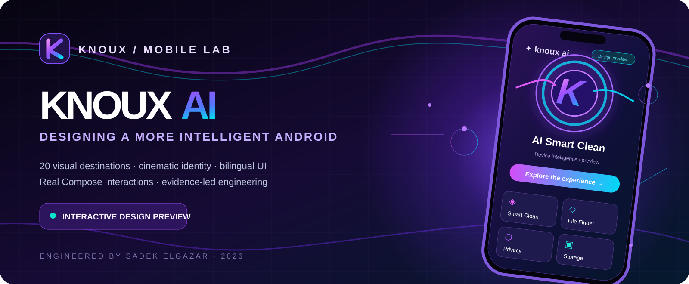

<br/>

# KNOUX AI
### A cinematic Android experience. Designed with intention. Engineered with evidence.

**A visual intelligence suite by KNOUX — from the first pixel to twenty interactive destinations.**

[](./app/)
[](./app/src/main/)
[](#-current-status--what-is-real)
[](#-bilingual-by-design)

[**The Visual Experience**](#-the-visual-experience) · [**Inside the App**](#-twenty-destinations-one-visual-language) · [**Development Chronicle**](#-the-development-chronicle) · [**Build & Verify**](#-build-and-verify) · [**عربي**](#-عن-المشروع)

</div>

---

> [!IMPORTANT]
> **KNOUX AI is presently an interactive Android *design preview* (version `0.1.0-preview`).** Its metrics, scans, file lists, cleanup estimates, optimizations and success states are sample UI fixtures—not measurements or actions on a real device. The app deliberately displays a **Design preview** disclosure. Device cleanup, scanning, privileged operations, persistence and production AI integrations are **not implemented** in this phase.

## ✦ The idea

Software for the device you carry every day should feel as considered as the device itself.

KNOUX AI began with that principle: take the visual language of modern creative software—luminous glass, dimensional icons, flowing aurora lines, unmistakable hierarchy—and give Android utility workflows a recognizable KNOUX identity.

This project is the **native Kotlin / Jetpack Compose exploration** of that idea: a cinematic entrance, a responsive dashboard, an interconnected screen system, ten feature destinations, and ten detailed service studios. Its purpose today is to **demonstrate and validate the experience**, rather than pretend unimplemented system features already work.

<div align="center">

### One visual signature. Many connected worlds.

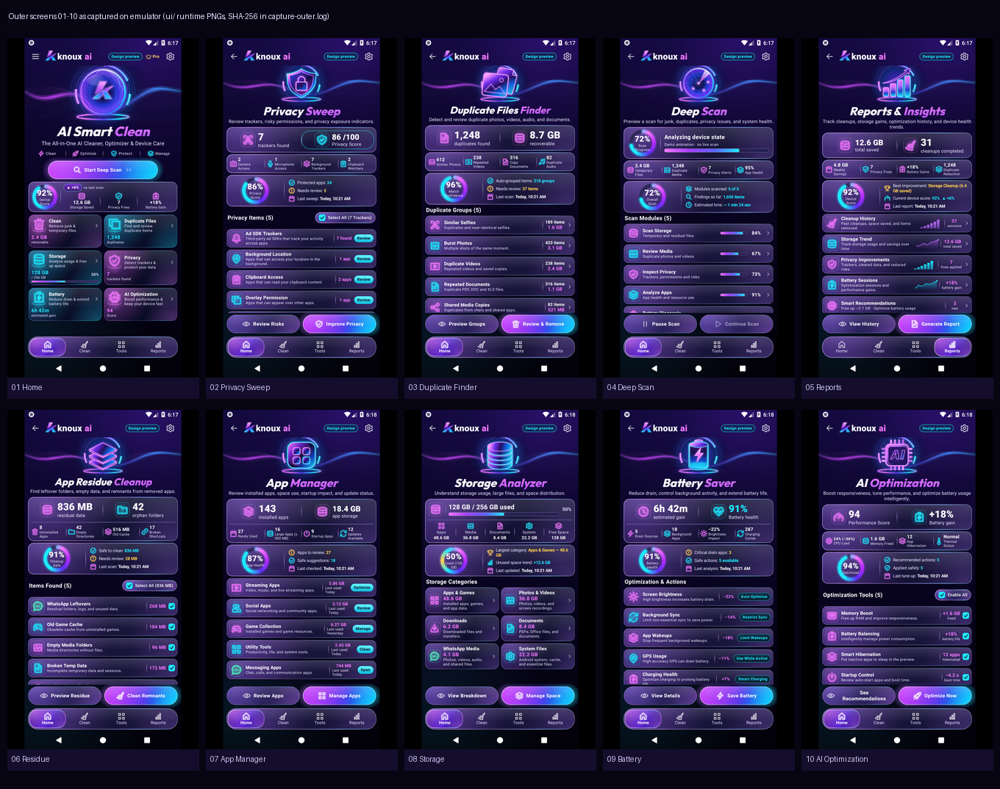

<sub>Actual emulator capture gallery from an earlier validated Phase 1 visual pass — not a marketing reconstruction. Runtime details may differ from the latest uncommitted service-studio refinement.</sub>

</div>

## ✨ The visual experience

### A signature that arrives before the interface

The startup journey combines a stylized KNOUX mark, glow choreography, orbital detail, and a controlled reveal into the main workspace. Motion is purposeful rather than decorative noise, with an alternative path for reduced-motion use.

<table>
<tr>
<td width="50%" align="center">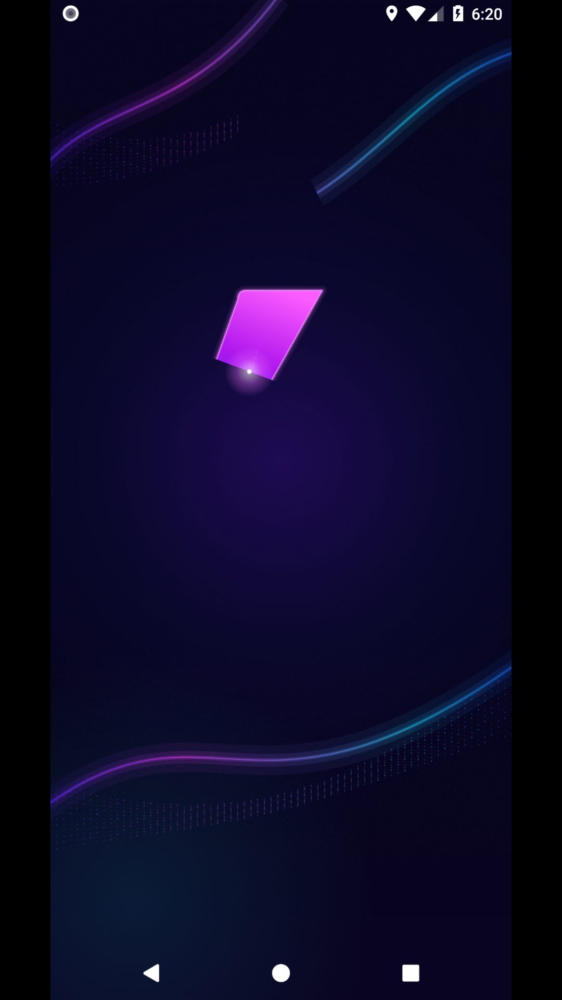<br/><sub>01 · The arrival</sub></td>
<td width="50%" align="center">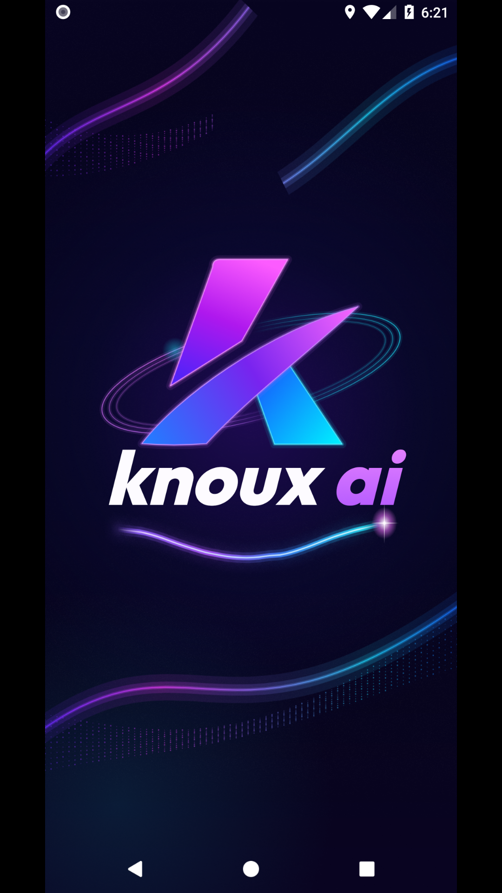<br/><sub>02 · The reveal</sub></td>
</tr>
</table>

### An interface built to be explored

<table>
<tr>
<td width="33%" align="center">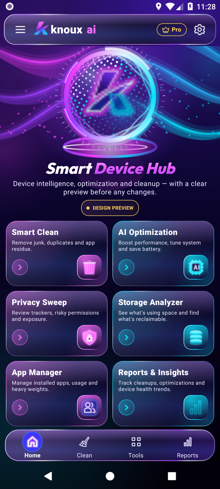<br/><b>01 — Smart Device Hub</b><br/><sub>Hero, identity, service navigation</sub></td>
<td width="33%" align="center">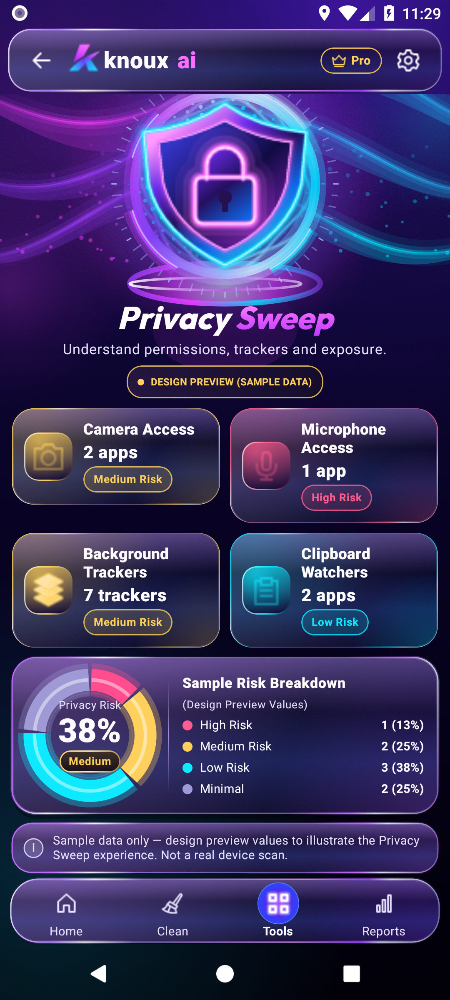<br/><b>02 — Privacy Sweep</b><br/><sub>Risk review and selected-action preview</sub></td>
<td width="33%" align="center">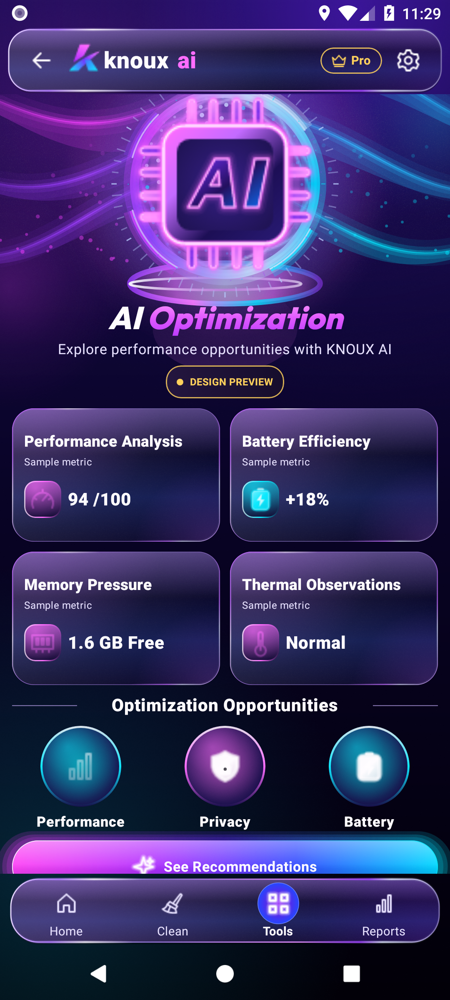<br/><b>03 — AI Optimization</b><br/><sub>Decision-oriented preview controls</sub></td>
</tr>
<tr>
<td width="33%" align="center">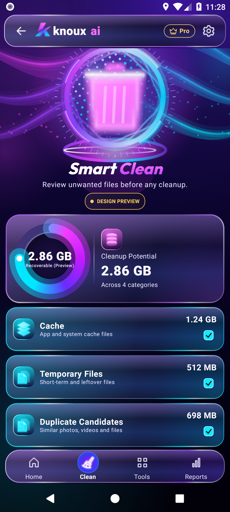<br/><b>04 — Smart Clean</b><br/><sub>Readable metrics and action states</sub></td>
<td width="33%" align="center">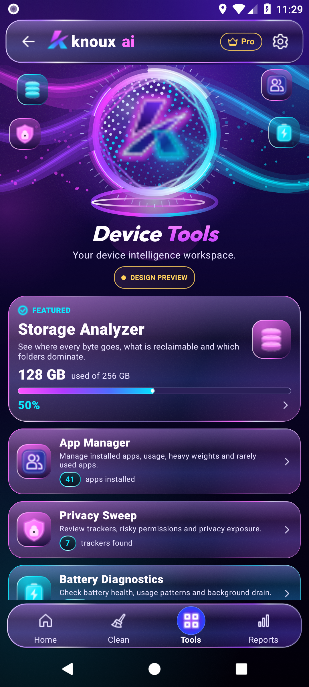<br/><b>05 — Tools</b><br/><sub>Organized service discovery</sub></td>
<td width="33%" align="center">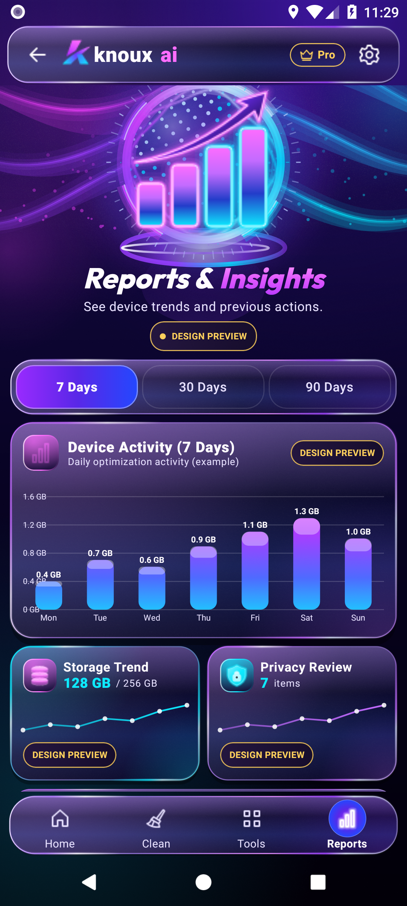<br/><b>06 — Reports</b><br/><sub>Data-storytelling, without fake measurements</sub></td>
</tr>
</table>

<details>
<summary><b>🌐 Arabic RTL experience — see a real device capture</b></summary>
<br/>
<div align="center">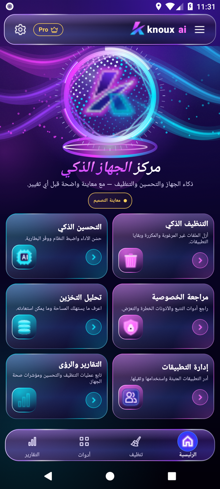<br/><sub>RTL navigation, mirrored layout, and localized presentation are part of the visual acceptance work.</sub></div>
</details>

## 🪐 Twenty destinations. One visual language.

The experience is organized as **10 reference feature screens** and **10 deeper in-product service studios**. Screens are real Compose destinations with navigation and preview interactions. The results shown inside are intentionally fictional design fixtures.

| The 10 feature destinations | The 10 detailed service studios |
|:---|:---|
| 🏠 AI Smart Clean / Home | 🧹 Smart Clean Center |
| ✨ Cinematic Splash | 🖼️ Duplicate Group Review |
| 🛡️ Privacy Sweep | 🔎 Privacy Risk Inspector |
| 🗂️ Duplicate Files Finder | 🪐 Deep Scan Summary |
| 📡 Deep Scan | 📊 Performance Report Detail |
| 📈 Reports & Insights | 🧩 Residue Item Review |
| 🧺 App Residue Cleanup | 🌌 Installed Apps Review |
| 💽 Storage Analyzer | 💿 Storage Breakdown |
| 🔋 Battery Saver | ⚡ Battery Diagnostics |
| 🧠 AI Optimization | ✧ AI Recommendations |

### What makes the interface feel alive

- **Layered glass and dimensional glyphs.** Rich purple/indigo surfaces, cyan and magenta edge lighting, controlled bloom, distinctive category colors.
- **Designed navigation.** Feature tiles, contextual review routes, reversible selections, confirmation sheets, and an explicit way back.
- **Cinematic motion with restraint.** Splash choreography, gauge and progress animation, responsive surfaces, motion-reduction options.
- **Arabic and English.** RTL/LTR layout handling, mirrored navigation, readable figures, and configurable presentation.
- **Truthful demonstrations.** Recomputed preview values and selections are interactive; simulated outcomes cannot silently mutate device data.
- **Evidence matters.** Android emulator captures, comparison images, source manifests, instrumentation checks, and documented known differences.

## 🕰️ The development chronicle

This is a chronology drawn from the actual repository history and local handoff records—not a claim about when the wider KNOUX company began.

| Milestone | Recorded work |
|---|---|
| **10 Nov 2026 — Foundation** | The first committed ten-screen native Compose baseline, approved reference material, and QA evidence were preserved (`f1b7971`). |
| **10 Nov 2026 — A cinematic identity** | The logo-driven entrance and signature splash entered the application (`5dcce02`). |
| **11 Nov 2026 — Refinement** | Screen fidelity, splash runtime and interaction consistency were iterated, with explicit handoff evidence (`823f6c6`, `68670c3`). |
| **11 Nov 2026 — A wider universe** | The UI evolved into a documented twenty-destination experience with visual-finish and emulator evidence (`ff9da8e` and later commits). |
| **11 Nov 2026 — Navigation & brand language** | More granular page navigation, dashboard reveal motion and approved reference reconstruction (`7f4ce64`, `99e351f`). |
| **12 Nov 2026 — Compact-viewport polish** | Header and hero adjustments to strengthen the fixed no-scroll primary-screen presentation (`112cbf6`). |
| **Current local refinement** | Distinctive service-world Compose modules and associated Android UI tests are being integrated and independently rechecked. |

<div align="center">
<b>From the first visual reference to native screen choreography, every stage should leave inspectable evidence.</b>
</div>

## 🧭 Current status — what is real?

| Area | Reality |
|---|---|
| Native Android application | **Implemented** — Kotlin, Jetpack Compose, Gradle |
| Ten primary feature screens | **Implemented as interactive previews** |
| Ten deeper service studios | **Source modules present; latest refinements require fresh QA** |
| Navigation, selections, sheets | **Implemented as UI interactions** |
| Cinematic splash and responsive visuals | **Implemented and captured in historical QA artifacts** |
| English / Arabic UI and RTL | **Implemented; device captures in the repository** |
| Real device scanning, cleanup, file deletion | **Not implemented** |
| Actual device battery optimization | **Not implemented** |
| Backend, Supabase, operational AI services | **Not implemented for this preview** |
| Public production release | **Not claimed** |

> [!NOTE]
> Historical tests and screenshots remain in `qa-evidence/`. They demonstrate the state of their specific builds; they do **not** automatically validate later uncommitted changes or certify production readiness. For any new release, rerun tests, review the current screenshots and link the exact tested commit SHA.

## 🏗️ Build and verify

**Environment:** Android Studio / Android SDK, JDK 17+ (local project handoff used JDK 21), Gradle wrapper included. Package `com.knoux.ai`; minSdk 26, targetSdk 36, compileSdk 36.

```powershell
git clone https://github.com/daynightae-cmyk/KNOUX-AI.git
cd KNOUX-AI

# Configure ANDROID_HOME to your own installed Android SDK.
# Do not commit local.properties or credentials.

.\gradlew.bat :app:assembleDebug
.\gradlew.bat :app:testDebugUnitTest
.\gradlew.bat :app:lintDebug

# If an emulator/device is connected and prepared:
.\gradlew.bat :app:connectedDebugAndroidTest
```

The binary is built under `app/build/outputs/apk/debug/`. Emulator screenshots and comparison procedures are described in [the Phase 1 handoff](./PHASE_1_HANDOFF.md) and the QA directories. Do not assume an emulator run passes solely because `assembleDebug` succeeds.

<details>
<summary><b>📁 Repository map</b></summary>

```text
KNOUX-AI/
├── app/                  Android Compose application & test sources
├── android/              Integration and future-phase references
├── design/               Original references, logo and visual system
├── database/             Future-phase planning material (not live backend)
├── prompts/              Execution briefs and phase follow-ups
├── qa-evidence/          Emulator captures, comparisons and historical QA
├── docs/                 Engineering/visual documentation & README artwork
├── scripts/              Capture and verification tooling
├── PHASE_1_HANDOFF.md    Engineering baseline and acceptance evidence
└── README.md             This visual project chronicle
```
</details>

## 🌍 عن المشروع

<div dir="rtl" align="right">

**KNOUX AI** هو مشروع أندرويد أصلي مبني بـ **Kotlin وJetpack Compose**، هدفه تقديم تجربة بصرية متميزة تجمع بين الزجاج البنفسجي، الإضاءة السماوية، الهوية السينمائية، والتنقل السلس بين عشرين وجهة تصميمية.

بدأنا بواجهات مرجعية، ثم بنينا شاشة دخول سينمائية، وطورنا الصفحات والأيقونات والحركة، ووصلنا إلى واجهات خدمات داخلية مستقلة، مع دعم العربية واتجاه **RTL**.

**الوضع الحقيقي حاليًا:** التطبيق معاينة تصميم تفاعلية. أرقام الفحص والتنظيف والتحسين المعروضة أمثلة توضيحية، وليست نتائج فحص الجهاز. الخدمات الفعلية والربط الإنتاجي مراحل لاحقة لا نعلن اكتمالها قبل إثبات التنفيذ والاختبارات.

الصور أعلاه مأخوذة من تشغيل Android الفعلي في مراحل التحقق السابقة، وليست مجرد تصورات تسويقية.

</div>

---

<div align="center">

### Built with vision. Proven through engineering.

**KNOUX** · Founded by **Eng. Sadek Elgazar**

[**KNOUX Website**](https://knoux.store/) · [**Project on GitHub**](https://github.com/daynightae-cmyk/KNOUX-AI) · **Android · Kotlin · Jetpack Compose**

<sub>README cover is original vector artwork created for this repository; runtime galleries are drawn from the project's QA evidence. KNOUX AI is not represented as a production device cleaner.</sub>

</div>
