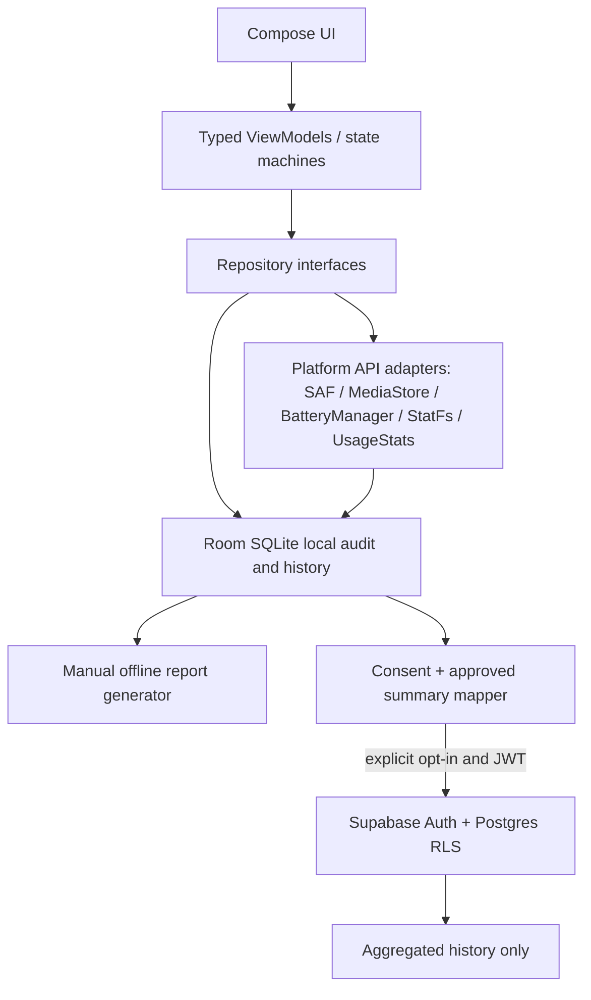

# Architecture — REAL DATA → LOCAL STORE → UI → OPTIONAL CLOUD

## Keep ON DEVICE (default)

- Photo/video/document URIs, titles, full paths, raw file content, SHA hashes, perceptual fingerprints, in-progress duplicate group members.
- Installed app names/package inventory and usage detail, raw privacy observations and notification content.
- Action selection, permissions status, and temporary indexes. If device export/sync is requested, a separate design review is mandatory.
- Room: sessions and actual state, media inventory, grouping, per-file selection, undo/trash evidence, service journals; DataStore: theme, locale, consent preferences; WorkManager: resumable foreground-appropriate scans.

## OPTIONAL opt-in cloud

- Account profile, device-generated rotatable UUID (not IMEI/Android ID), scan summaries, aggregate counts, verified action totals and anonymized recommendation codes, timestamps.
- Use RLS and authenticated user; offline app remains fully functional when cloud disabled.
- Even aggregate metrics can be personal when linked to account. Consent is revocable, remote deletion/retention described clearly. Do not upload identifiers or copy local content to a cloud "AI" API by default.

## Trust boundaries

1. A server cannot scan Android sandboxed files on its own; client API permissions are decisive.
2. Android app must request least privilege and show OS-mediated confirmation for destructive operations.
3. UI preview fixtures must be isolated by build flavor/state so never flow into real reports, cloud, ads, billing, or store claims.
4. Actions journal distinguishes `requested`, `approved`, `completed`, `cancelled`, `failed` and stores actual bytes only after independent observed before/after measurements, with caveats for concurrent changes.
5. All services handle denied permission, partial media grants, OEM variations, device locked, low memory, process death, and offline use.

## Storage estimates

Use `StatFs` for available total bytes on eligible volume and scoped MediaStore/SAF for user-visible assets. Android may not expose precise ownership/category attribution for every app. Sum categories only when mutually exclusive partitions are verified; don't count WhatsApp media twice as photos + app storage.

## Privacy/security

- Data minimization, opt-in cloud, privacy policy, retention, deletion/export, TLS, RLS, no client secret/service-role key, encrypted app-private storage where justified, no screenshots/logcat of personal data in CI.
- Don't add AccessibilityService, VPN, Shizuku, root, ADB, Notification Listener or Device Admin capabilities without a separate core-use-case/security/Play review and explicit informed consent.
